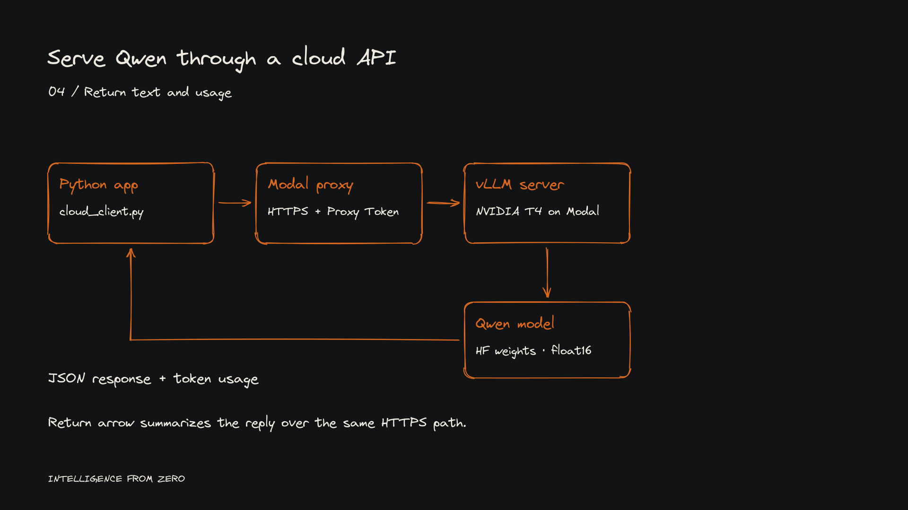

# DomainOS managed inference lab

**An authenticated Qwen API on a cloud T4, from deployment to measured experiment cost.**

This lab connects a Python application to Qwen2.5-1.5B-Instruct served by vLLM on Modal. It packages the original cloud experiment, a local Unsloth client, explicit authentication checks, and a reproducible deployment definition.



## Experiment results · 19 October 2026

| Observation | Result |
| --- | --- |
| Direct authenticated inference | HTTP 200, generated text and JSON token usage |
| Invalid Proxy Token | HTTP 401 |
| Example response usage | 42 input + 126 output = 168 tokens |
| Example end-to-end elapsed time | 161.44 seconds, including cold-start waiting |
| App usage | $0.18: T4 $0.13, CPU $0.04, memory $0.01 |
| Dashboard requests | 74 total; 3 successful responses; 71 reported errors |

These are the recorded Lab 5–6 results recovered from the experiment conversation. Original screenshot pixels were unavailable during packaging. [Evidence and analysis](docs/experiment-report.md) distinguish those observations from this package's local checks. The user reported stopping the application after the experiment.

The cloud model is the Hugging Face checkpoint loaded in float16. The separate local client targets the Q4_K_M GGUF model through Unsloth's API; no local GGUF upload is part of the cloud deployment.

## Start locally · no cloud compute

Use Python 3.12, matching the cloud image. The HTTP client and tests use the standard library.

```sh
python3 -m venv .venv
source .venv/bin/activate
python -m pip install -r requirements.txt
python -m unittest discover -s tests -v
python scripts/audit_secrets.py
```

The offline tests use a temporary loopback HTTP server. They never call Modal. Importing client modules sends no requests. The Cloud CLI scripts require `--allow-cloud` before making requests.

## Deploy and call the API

Follow [the deployment runbook](docs/getting-started.md). Deployment, GPU inspection, authenticated readiness requests and inference can consume cloud credits. Obtain approval before running them in this workspace.

After an approved deployment, configure `ENDPOINT` privately and run:

```sh
python cloud_client.py --allow-cloud --wait-ready
python security_test.py --allow-cloud
```

The client prompts for Proxy Token credentials with hidden input. It polls **GET /v1/models** on 503 only when `--wait-ready` is selected, then sends one chat request. A failed or timed-out chat request is not automatically resubmitted.

## What's inside

| Files | Purpose |
| --- | --- |
| `qwen_vllm.py` | Modal server, pinned vLLM, T4, cached Hugging Face weights |
| `client.py`, `auth_test.py` | Local authenticated Unsloth client and invalid-key check |
| `cloud_client.py`, `cloud_inference_test.py` | Direct HTTPS inference; no Modal CLI needed for requests |
| `readiness_test.py`, `security_test.py` | Model readiness and missing/invalid/valid authentication checks |
| `gpu_test.py`, `modal_test.py` | Explicitly gated remote GPU and CPU checks |
| `lab_http.py`, `lab_cli.py`, `tests/` | Shared HTTP logic, CLI entrypoints and offline regression suite |
| `docs/architecture/` | SVG, editable Excalidraw, JSON spec and source-backed architecture notes |
| `docs/experiment-report.md`, `evidence/` | Results, provenance and measured economics |
| `docs/tutorial/` | Engineering tutorial companion and recording sequence |
| `docs/architecture/renderer/` | Reproducible handwritten diagram renderer |
| `docs/security-review.md` | Audit findings and publication boundaries |

## Engineering lessons

Scale-to-zero saved idle capacity but introduced a long first-request wait. Readiness probes contributed to dashboard error counts. The original DomainOS prompt also produced an inaccurate product description, illustrating why a served model needs authoritative domain context and answer evaluation.

This demonstrates deployment and basic authentication enforcement. Customer-scoped authorization, tenant isolation and production availability require separate engineering and validation. The $0.18 experiment is not a production unit-price benchmark.

## Documentation

- [Getting started and stop procedure](docs/getting-started.md)
- [Architecture and component settings](docs/architecture.md)
- [Experiment report and economics](docs/experiment-report.md)
- [Screenshot provenance and sanitization](evidence/README.md)
- [Tutorial engineering companion](docs/tutorial/README.md)
- [Handwritten diagram sources and rebuild instructions](docs/architecture/README.md)
- [Security audit and publication gate](docs/security-review.md)

Built with [Modal Servers](https://modal.com/docs/guide/servers), [Modal Proxy Tokens](https://modal.com/docs/guide/webhook-proxy-auth), [vLLM 0.11.2](https://docs.vllm.ai/en/v0.11.2/serving/openai_compatible_server/) and [Qwen2.5-1.5B-Instruct](https://huggingface.co/Qwen/Qwen2.5-1.5B-Instruct). Model and dependency licenses remain with their respective authors. No project redistribution license has been selected yet.
