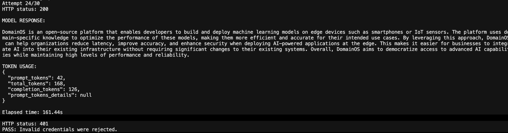

# DomainOS Managed Inference Lab

**Deploy Qwen on a cloud T4 and call it through an authenticated Python API.**

I built this lab to take an open-weight model from local inference to a cloud service. I ran a Q4_K_M GGUF model through Unsloth, deployed Qwen2.5-1.5B-Instruct with vLLM on Modal, connected a Python client, tested authentication, and measured resource usage.

## Video walkthrough

[**Watch the complete tutorial on YouTube →**](https://youtu.be/sbAmuF1waQw)

Follow the build from local Qwen inference to a GPU-backed cloud API: deployment, Python integration, readiness checks, authentication tests, token usage and compute costs.

[DomainOS Managed Inference](https://ethercess.com/intelligence-os/managed-inference/) · [Setup and deployment guide](docs/getting-started.md) · [Architecture](docs/architecture.md)


## Results · 19 October 2026

| Test or measurement | Result |
| --- | --- |
| Local inference | Qwen GGUF Q4_K_M served through the Unsloth API |
| Remote GPU | NVIDIA Tesla T4 |
| Authenticated cloud inference | HTTP 200 with generated text and token usage |
| Invalid cloud credentials | HTTP 401 |
| Captured cloud response | 42 input + 126 output = 168 tokens |
| End-to-end elapsed time | 161.44 seconds, including cold-start waiting |
| Compute cost | $0.18369727, rounded to **$0.18** |
| Network egress | $0.00416760 |
| Captured billing total | $0.18786487, rounded to **$0.19** |

I stopped the application after the experiment. The [experiment report](docs/experiment-report.md) includes the screenshots, resource breakdown and engineering lessons.



## Run the local checks

Use Python 3.12, matching the cloud image.

```sh
python3 -m venv .venv
source .venv/bin/activate
python -m pip install -r requirements.txt
python -m unittest discover -s tests -v
python scripts/audit_secrets.py
```

The 33 regression tests use a local HTTP server and mocked readiness checks. The clients use Python's standard library.

## Deploy and call the model

Follow the [setup and deployment guide](docs/getting-started.md) to configure Modal and deploy `qwen_vllm.py`. Cloud requests can activate billed GPU compute; the scripts require `--allow-cloud` to make that explicit.

```sh
python readiness_test.py --allow-cloud --wait-ready
python cloud_client.py --allow-cloud --wait-ready
python security_test.py --allow-cloud
```

Enter the Proxy Token ID and secret at the hidden prompts. The client checks `/v1/models` during startup, then submits one chat-completion request. After the session, stop the deployment:

```sh
modal app stop domainos-qwen-vllm-lab
```

## How it works

The local path uses Unsloth's OpenAI-compatible API and a quantized GGUF model. The cloud path uses the Hugging Face Qwen checkpoint in float16, served by vLLM on a Modal T4. Modal's proxy authenticates HTTPS requests before routing them to the server.

The deployment uses a persistent model-cache volume, a 2048-token context limit, a maximum of one GPU container, and a 30-second idle scale-down window. See the [architecture and configuration](docs/architecture.md).

## Repository map

| Files | Purpose |
| --- | --- |
| `qwen_vllm.py` | Modal + vLLM deployment and model cache |
| `client.py`, `auth_test.py` | Local Unsloth client and invalid-key test |
| `cloud_client.py`, `cloud_inference_test.py` | Direct authenticated cloud inference |
| `readiness_test.py`, `security_test.py` | Readiness and missing/invalid/valid credential checks |
| `gpu_test.py`, `modal_test.py` | Remote T4 and CPU checks |
| `lab_http.py`, `lab_cli.py`, `tests/` | Shared client logic and regression tests |
| `docs/architecture/` | Editable handwritten diagrams and renderer |
| `evidence/` | Screenshots, measurements and billing data |

## What I learned

The serving path worked, and the first cloud response exposed the cost of cold starts. I separated readiness polling from generation so the client waits for the model, then submits the chat request once.

The model also invented an inaccurate description of DomainOS. That made the next system requirement clear: provide authoritative product context and evaluate factual answers alongside the serving infrastructure.

The cost figures include startup and test traffic. The authentication checks cover access to this lab endpoint; customer deployments need customer-scoped authorization and isolation.

## Documentation

- [Setup and deployment](docs/getting-started.md)
- [Architecture](docs/architecture.md)
- [Experiment report](docs/experiment-report.md)
- [Screenshots and measurements](evidence/README.md)
- [Tests and validation](docs/validation.md)
- [Authentication and secrets](docs/security-review.md)
- [Tutorial outline](docs/tutorial/README.md)
- [Editable diagrams](docs/architecture/README.md)

Built with [Modal](https://modal.com/docs/guide/servers), [vLLM 0.11.2](https://docs.vllm.ai/en/v0.11.2/serving/openai_compatible_server/) and [Qwen2.5-1.5B-Instruct](https://huggingface.co/Qwen/Qwen2.5-1.5B-Instruct).
