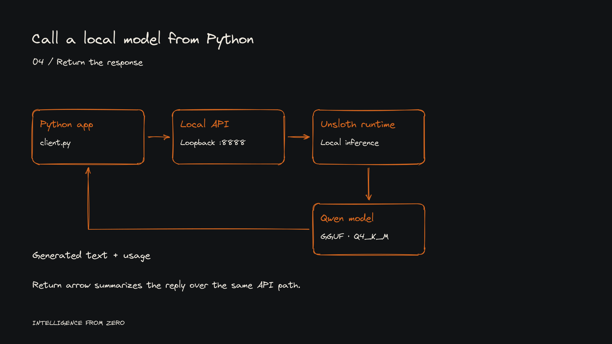
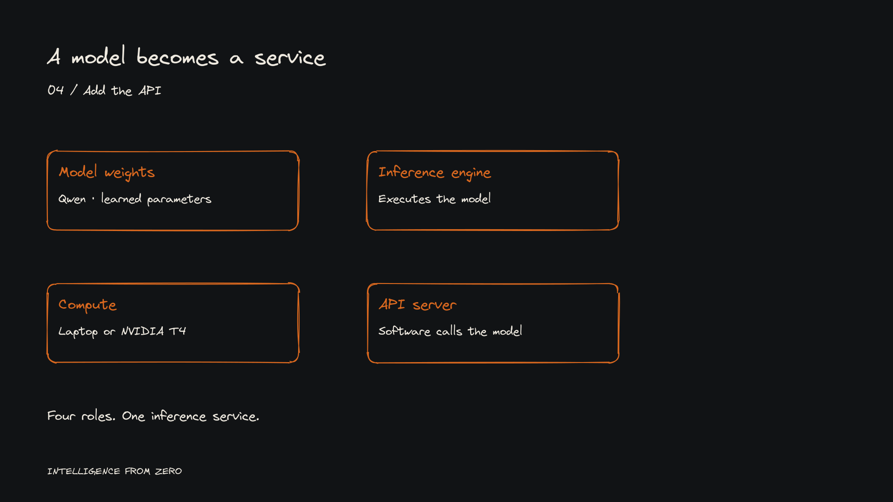

# Architecture

The application sends an authenticated HTTPS request to Modal's proxy. The proxy checks a Proxy Token before routing to vLLM. vLLM loads Qwen2.5-1.5B-Instruct on a T4 and returns an OpenAI-compatible chat completion with token usage.

The separate local path is `Python → loopback HTTP :8888 → authenticated Unsloth API → Q4_K_M GGUF`. The cloud definition refers to the upstream Hugging Face model ID, not the local GGUF artifact. Local and cloud success establish two serving paths, not a controlled model-quality comparison.

## Source settings

| Setting | Value in `qwen_vllm.py` |
| --- | --- |
| App | `domainos-qwen-vllm-lab` |
| Server | `QwenServer` |
| Base image / Python | CUDA 12.8.0 devel, Ubuntu 22.04 / Python 3.12 |
| Dependencies | vLLM 0.11.2; huggingface-hub 0.36.0 |
| GPU / CPU / RAM | T4 / 2 / 8192 MiB |
| Model / API alias | `Qwen/Qwen2.5-1.5B-Instruct` / `domainos-qwen` |
| Host / port | `0.0.0.0` / 8000 |
| Numeric type | float16 |
| Context limit | 2048 tokens |
| GPU memory utilization | 0.75 |
| Execution | `--enforce-eager` |
| Cached weights | `domainos-qwen-cache` mounted at `/root/.cache/huggingface` |
| Container limits | minimum 0, maximum 1 |
| Target / hard request concurrency | 1 / 1 |
| Idle scale-down window | 30 seconds |
| Startup timeout | 600 seconds |
| Public unauthenticated access | disabled |

`@modal.enter()` launches vLLM; `@modal.exit()` terminates and waits for the subprocess, escalating to a kill if needed. Lab 7 adds the bounded shutdown handling without changing the original serving configuration.

Modal documents that Servers return 503 while scaling from zero, and reject unauthenticated requests before autoscaler accounting. These semantics explain why HTTP errors must be classified before interpreting the dashboard count as model-generation reliability. [Modal Servers](https://modal.com/docs/guide/servers)

## Editable diagrams

The diagrams follow the handwritten tutorial style: Virgil text, rough orange strokes, warm light text on neutral charcoal previews and a presenter-safe right side. Native sources use a light-source palette.

`architecture/architecture.excalidraw` is the cloud overview alias. The named local, cloud, roles, auth, readiness, economics and recap scenes retain editable objects. Each has dark/light SVG exports. See [diagram sources and rebuild instructions](architecture/README.md) for the pinned renderer, final-state source spec and output manifest.

The full 26-state progressive-reveal production master lives in the canonical tutorial library. The files here are reviewed distribution snapshots, not a second production master. Every reveal was rendered and inspected; native editor import/edit and appearance interaction checks remain pending because the available browser interface did not expose a working file import.

These are architecture drawings, not execution screenshots. They contain no account names, private server origins or credentials.
