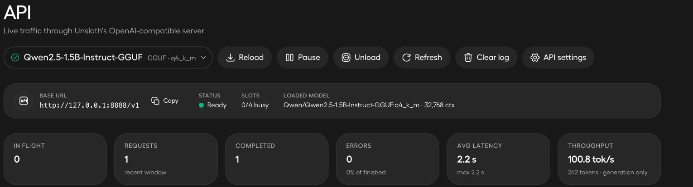
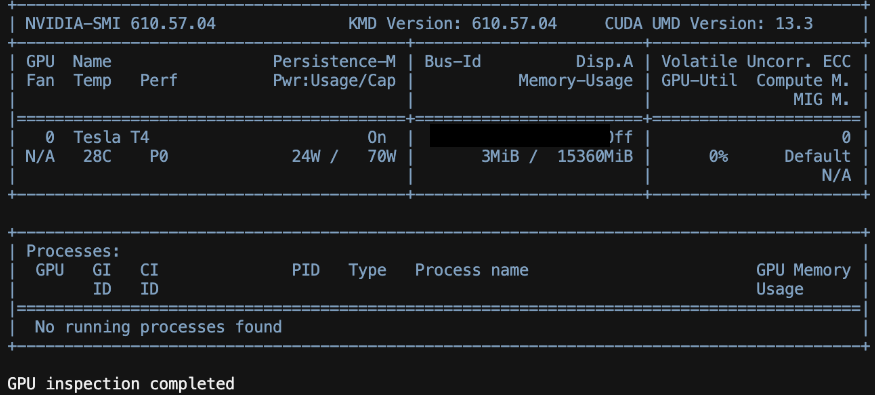
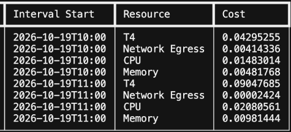

# Experiment report

**Date:** 19 October 2026

**Stack:** Unsloth, Python, Modal, NVIDIA T4, vLLM and Qwen2.5-1.5B-Instruct

I started with a local Qwen GGUF model and finished with an authenticated cloud inference endpoint. The Python client returned a model response with HTTP 200, the invalid-token test returned HTTP 401, and I captured the resource costs before stopping the application.

## 1. Local inference

I loaded Qwen2.5-1.5B-Instruct in Q4_K_M GGUF format through Unsloth and enabled its OpenAI-compatible API at `http://127.0.0.1:8888/v1`. The API monitor shows the loaded model, ready status, a completed request and zero errors in the displayed window.

The local Python client sent chat-completion requests independently of the Unsloth chat interface.

## 2. Cloud GPU

I verified remote GPU access with `nvidia-smi`. The worker identified an NVIDIA Tesla T4 with 15360 MiB of GPU memory and completed the inspection.

## 3. Cloud inference and authentication

I deployed `Qwen/Qwen2.5-1.5B-Instruct` in float16 with vLLM 0.11.2. The server used the API alias `domainos-qwen` and Modal Proxy Token authentication.

| Measurement | Result |
| --- | --- |
| Authenticated chat completion | HTTP 200 |
| Successful attempt | 24 of 30 |
| Prompt tokens | 42 |
| Completion tokens | 126 |
| Total tokens | 168 |
| End-to-end elapsed time | 161.44 seconds |
| Invalid-token test | HTTP 401; rejected |

The app dashboard recorded 74 requests: three successful responses and 71 errors. The elapsed time above includes startup waiting and repeated HTTP 503 responses. The current client separates readiness probes from generation: it polls `/v1/models` when `--wait-ready` is selected, then sends one chat request.

## 4. Resource costs

The hourly billing capture contains two intervals for the inference app. I summed those rows by resource:

| Resource | USD |
| --- | ---: |
| NVIDIA T4 | 0.13342940 |
| CPU | 0.03563575 |
| Memory | 0.01463212 |
| **Compute subtotal** | **0.18369727** |
| Network egress | 0.00416760 |
| **Total** | **0.18786487** |

Compute rounded to **$0.18**. Including network egress, the captured billing rows rounded to **$0.19**.

The [billing rows](../evidence/billing-rows.csv) and [resource totals](../evidence/economics.csv) preserve the calculation. The earlier rounded compute breakdown was T4 $0.13, CPU $0.04 and memory $0.01.

Across the experiment's three successful responses, the compute subtotal allocates about **$0.06 per successful response**, including startup and testing overhead. The 168-token measurement above belongs to the single captured response.

## 5. Engineering lessons

**Cold starts affected the first response.** Scaling to zero after 30 idle seconds reduced idle capacity and introduced startup waiting. Readiness and completion-request duration now have separate timers.

**Serving and factual grounding are separate responsibilities.** The captured answer incorrectly described DomainOS as an edge-device platform. I changed the default demo prompt to a generic inference question and identified authoritative context plus factual evaluation as the next application layer.

**Authentication needs a positive control.** The security script checks missing and invalid credentials, then confirms that valid credentials reach the expected model.

**Usage needs a matching measurement window.** The resource bill covers startup and test traffic. A warm-workload benchmark should match its request timestamps, token counts and resource charges.

## Code and tests

I consolidated the HTTP logic, bounded readiness polling, blocked redirects, capped response size, kept credentials in hidden prompts or environment variables, and added failing exit statuses for unexpected results. The regression suite contains 33 passing tests. See the [validation record](validation.md).
